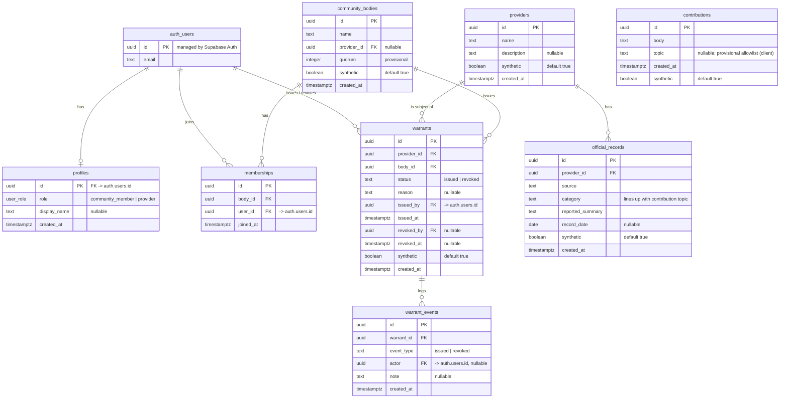

# Database diagram — MVP #1

All tables live in Supabase (Postgres). Every table has Row Level Security
enabled. Data is synthetic only; insert policies reject non-synthetic rows.

## Notes

- **contributions** is intentionally unlinked to any user — anonymity by default
  (see ADR 0004). It is public-read; inserts allowed only when `synthetic = true`.
- **profiles / memberships** carry identity and are scoped by RLS (own row / self
  only). `memberships` enforces self-organized joining: a user may add or remove
  only themselves.
- **warrants** is a public register (anyone may read); insert/update is allowed
  only to members of the issuing body, as themselves.
- **warrant_events** is an append-only audit trail (the "receipt") of issue /
  revoke actions.
- `auth_users` is Supabase's built-in `auth.users`; shown here for relationships
  only (not created by our migrations).
