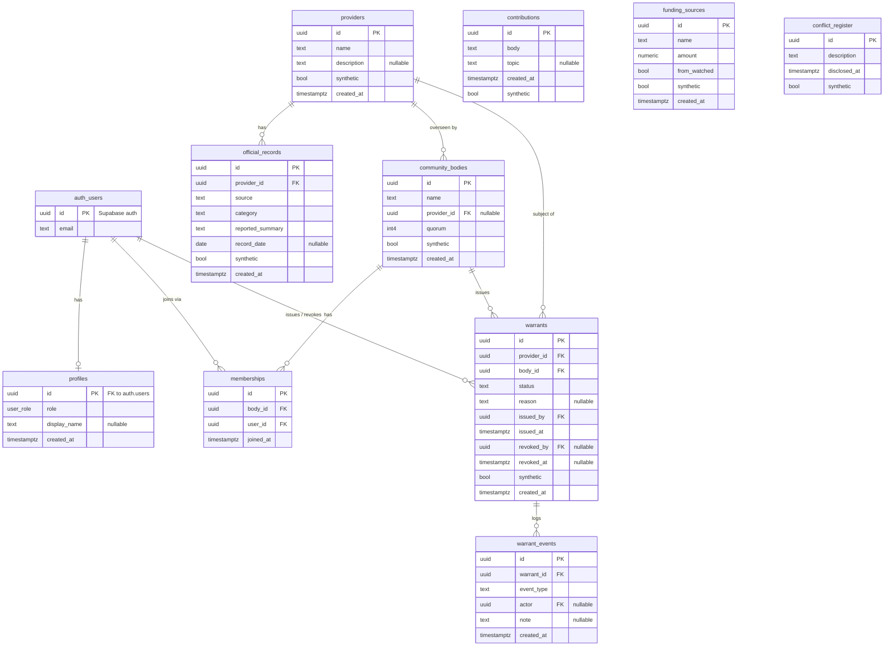

# Database diagram — MVP #1

The rendered diagram (with a key) is **[`database-diagram.svg`](database-diagram.svg)**:

All tables live in Supabase (Postgres). Every table has Row Level Security
enabled, and all data is synthetic only (insert policies reject non-synthetic
rows). The Mermaid source below mirrors the SVG.

## Notes

- **contributions** is intentionally unlinked to any user — anonymity by default
  (see ADR 0004). Public-read; inserts allowed only when `synthetic = true`.
- **funding_sources** and **conflict_register** also stand alone (public-read).
- **profiles / memberships** carry identity and are scoped by RLS (own row / self
  only). `memberships` enforces self-organized joining: a user may add or remove
  only themselves.
- **warrants** is a public register; insert/update is allowed only to members of
  the issuing body. **warrant_events** is an append-only audit trail (the receipt).
- **official_records** inserts are restricted to provider-role users (see ADR 0007).
- `auth_users` is Supabase's built-in `auth.users`; shown for relationships only.

Key / notation: `PK` primary key · `FK` foreign key · `nullable` may be empty ·
a crow's-foot (fork) on a relationship line means "many".
