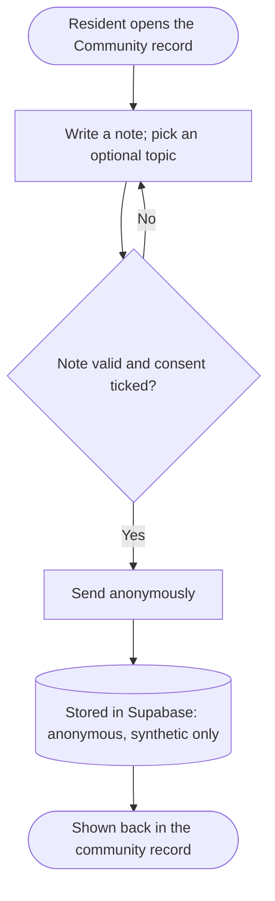
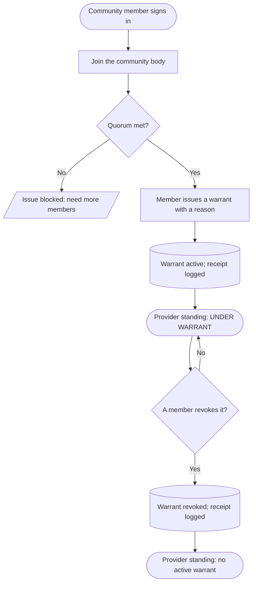
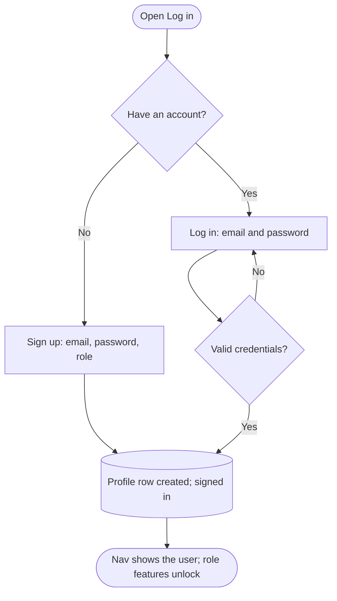

# Flow Charts — MVP #1

The key user flows, drawn from the use cases in `use-cases.md`. GitHub renders the
Mermaid diagrams below. All data is synthetic this phase.

## 1. Anonymous contribution (Resident)

A contribution never carries identity, and the consent step must be ticked before it can be sent.

## 2. The warrant: issue and revoke (Community body)

Issuing and revoking are explicit community actions by body members, gated on quorum, and every action logs an audit receipt.

## 3. Sign-up / login

Accounts exist only for roles that must be identified (community members, providers); contributing stays anonymous and needs no account.
