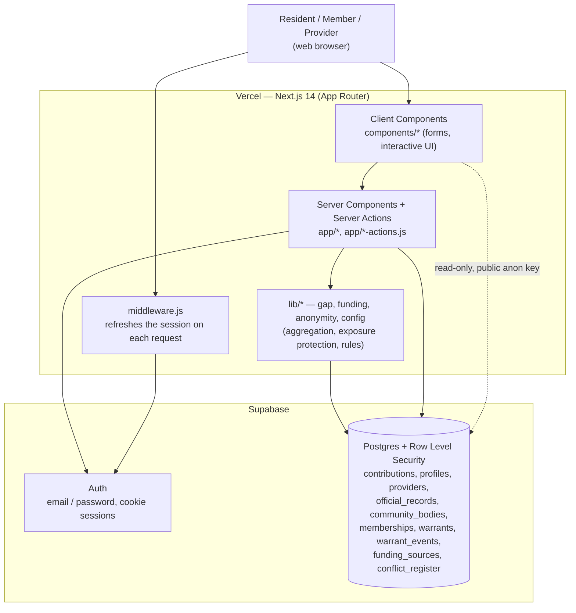

# System Architecture — MVP #1

Current as of 2026-11-01. A one-page overview of how the deployed app fits
together: the tiers, where each kind of logic runs, how a request flows, and how
sessions work. Decisions behind these choices are in `docs/adr/`; the stack itself
is in `docs/tech-stack.md`; the data tier is in `docs/database-architecture.md`.

## The three tiers

1. **Presentation** — React/MUI screens. A mix of Server Components (default) and
   Client Components (`components/*`) for interactive pieces (forms, toggles).
2. **Application** — the privacy-sensitive logic, running on the server inside
   Next.js: Server Actions (`app/*-actions.js`) for writes, and pure helpers in
   `lib/*` for aggregation and rules (`gap.js`, `funding.js`, `anonymity.js`,
   `config.js`). This is where exposure protection and role checks live.
3. **Data** — Supabase: Postgres (10 tables, RLS on every one) + Auth.

## Component diagram

## How a request flows

- **Reading the public record / gap / warrant register:** a Server Component (or a
  public read with the anon key) queries Postgres; RLS allows public read; `lib/`
  helpers compute the gap and apply exposure protection (small counts masked)
  before anything renders. No score is produced.
- **Contributing a note (anonymous):** a Client form posts to a Server Action; the
  payload is stripped to `body`, `topic`, `synthetic` (anonymity rail) and
  inserted; RLS allows anonymous synthetic insert only.
- **Acting as a member/provider (issue/revoke a warrant, add an official record):**
  a Server Action runs with the user's session; RLS checks membership or role at
  the data tier, so an unauthorized call fails even if the UI is bypassed. An
  append-only receipt is written for warrant actions.

## Authentication & sessions

- Supabase Auth (email/password) via `@supabase/ssr`: a browser client
  (`lib/supabaseClient.js`), a server client (`lib/supabaseServer.js`), and
  session-refresh middleware (`lib/supabaseMiddleware.js` wired in `middleware.js`).
- Sessions are cookie-based and refreshed on each request by the middleware.
- Only the public anon/publishable key is present client-side; the service-role key
  is never used in the app. The server client returns null when env is absent, so
  the build does not require secrets.

## Security posture (in brief)

Defense in depth: anonymity enforced structurally (no identity columns + CI test),
RLS as authoritative access control on every table, least privilege per role,
secrets kept server-side, and synthetic-only inserts. Full detail in
`docs/security.md`.

## Deployment & CI

- **Hosting:** Vercel, root directory `Week4/web`, auto-deploy on push to `main`;
  Supabase env vars set in the Vercel dashboard. (See `docs/devops.md` once added.)
- **CI:** GitHub Actions runs lint, tests (including the anonymity rail), and a
  build check.
- **Database changes:** SQL migrations in `Week4/supabase/migrations/`, applied in
  the Supabase SQL editor; safe to re-run.

> **Known gap (tracked for the DevOps item):** the current CI workflow targets the
> old `Week3/` folders, not `Week4/web` where the deployed app lives, so CI is not
> yet guarding the Week 4 code. To be fixed as part of the DevOps write-up.

*Related: `docs/tech-stack.md`; `docs/database-architecture.md`; `docs/adr/`;
`docs/security.md`.*
